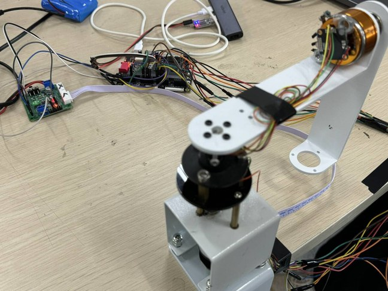
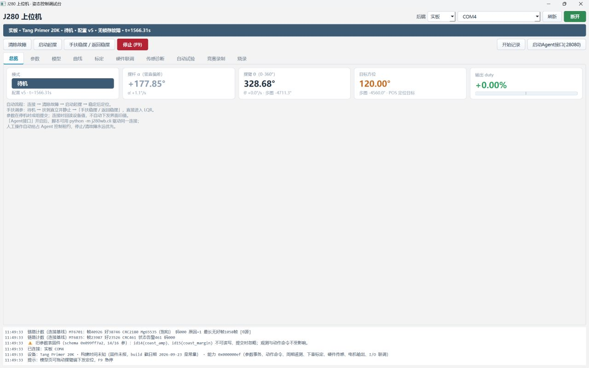
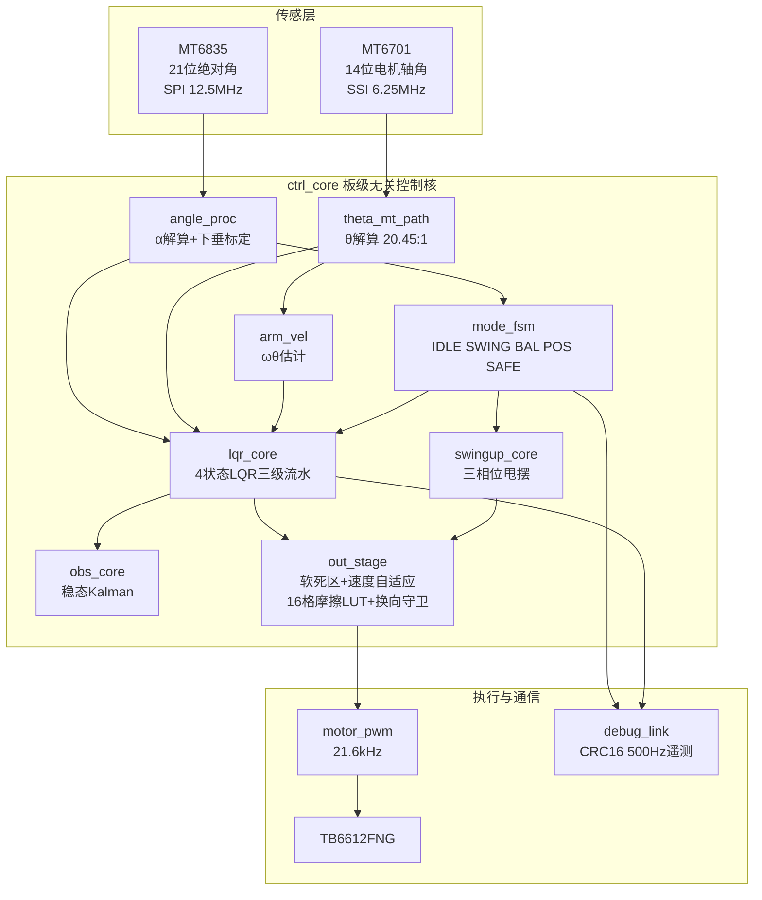
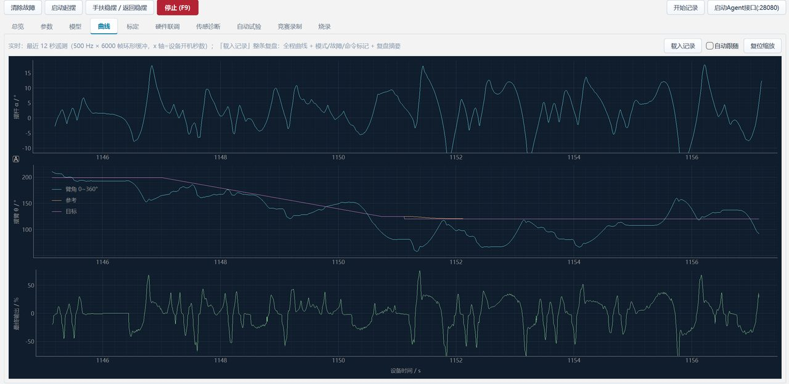
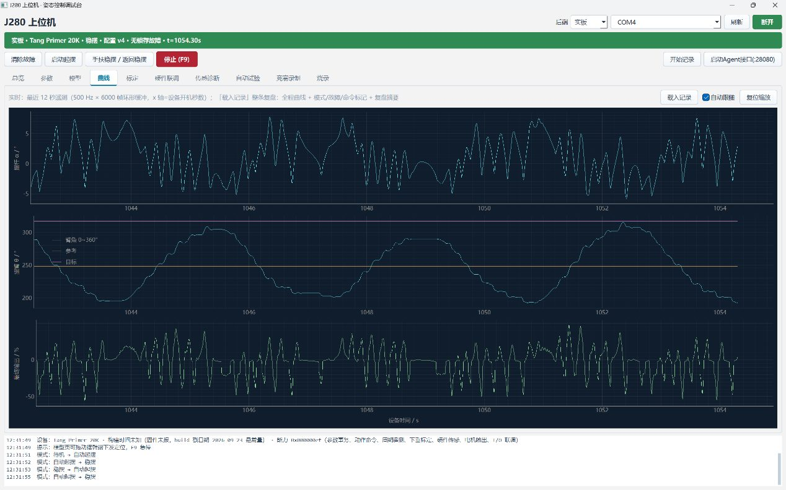
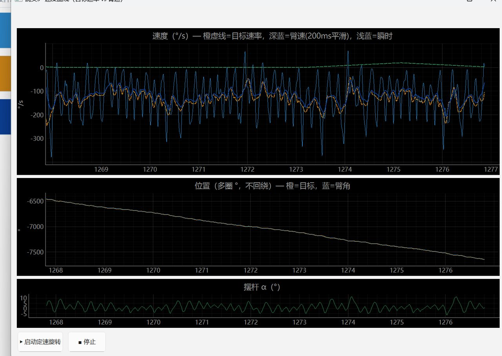
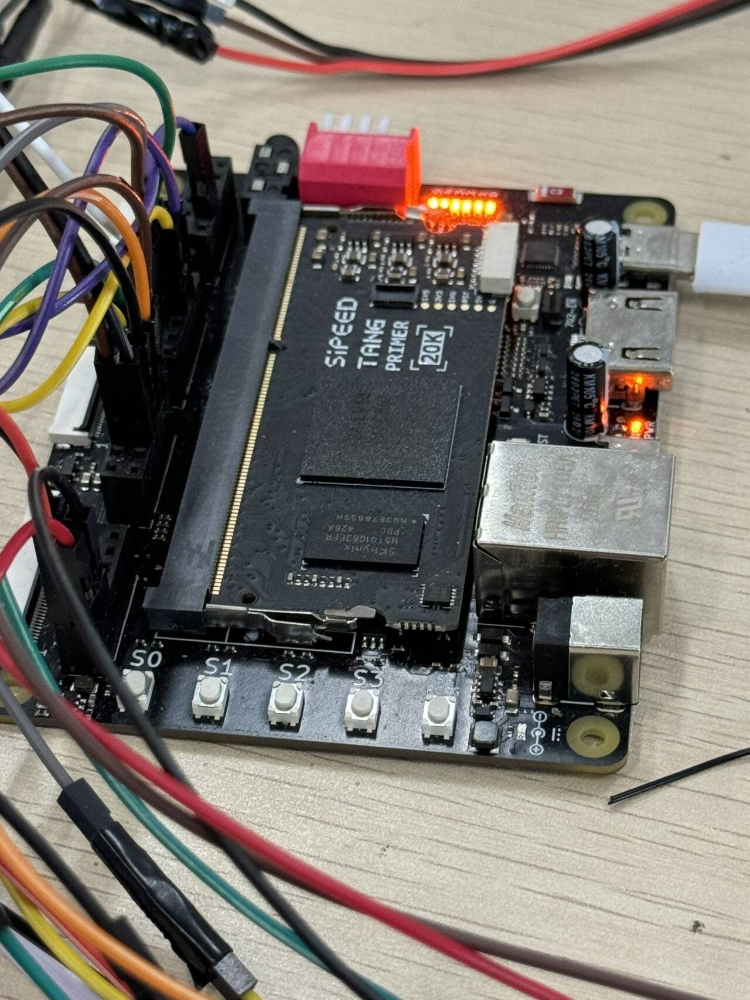

<div align="center">

# 🔄 Rotary Inverted Pendulum on FPGA

**一根杆，一块 FPGA，1 kHz 全定点闭环 —— 从甩摆到精确停位，全部硬件完成。**

[](LICENSE)
[](docs/hardware.md)
[]()
[]()
[]()
[](CONTRIBUTING.md#当前回归状态)

[快速开始](#-快速开始) · [架构](#-架构) · [性能](#-实测性能) · [文档](#-文档) · [已知限制](#-工程真相)

</div>

---

## ⚡ 这是什么

一个**欠驱动、开环不稳定**系统的完整硬件控制实现。摆杆只能通过旋转臂的加速度间接控制——臂转快了杆会倒，臂不动杆也会倒。全部控制律在 FPGA 里以 **1 kHz 节拍、全定点运算**完成，无 CPU、无中断、无浮点。

<div align="center">
<br/>
<sub>桌面级实验装置：白色底座 + 铝合金摆臂绕竖直轴转 θ，末端铰接摆杆绕水平轴摆 α，关节处金色伺服/减速电机，底部 12 V 直流驱动电机</sub>
</div>

▶️ **[124 秒演示视频](docs/images/demo.mp4)**（4.2 MB）—— 悬垂 → 自动起摆 → 稳摆 → 上位机实时波形

**它能做的事**：自己把杆甩起来 → 稳住 → 按你指定的 0~360° 绝对角度走过去 → 用静摩擦锁死保持（电机输出归零，零功耗）。

<div align="center">
<br/>
<sub>上位机「总览」页：模式 / 摆杆 α / 摆臂 θ（多圈）/ 目标方位 / 输出 duty，下方为链路健康日志</sub>
</div>

---

## 🎯 三个核心能力

<table>
<tr>
<td width="33%" align="center">

### 🚀 自动起摆
三相位甩摆 + 捕获窗

`单杆捕获 1.0~1.3 s`

</td>
<td width="33%" align="center">

### ⚖️ 稳摆自平衡
4 状态 LQR 全反馈

`摆角 RMS 1.9~3.2°`

</td>
<td width="33%" align="center">

### 🎯 绝对定位
0~360° 最短路 + 静摩擦锁

`执行精度 Δ=0.0°`

</td>
</tr>
</table>

---

## 🚀 快速开始

### 无硬件：跑仿真

```bash
git clone https://github.com/mefory/j280-rotary-pendulum.git
cd j280-rotary-pendulum

bash sim/run_sim.sh            # 全部回归（9 项，约 15 min）
bash sim/run_sim.sh lqr_core   # 单项（秒级）
```

> 需要 Icarus Verilog 11+。脚本已内置 `-g2012` 与顶层模块指定。

### 有硬件：构建 + 上位机

```powershell
# 1. 构建位流（需 Gowin EDA 1.9.x）
.\build\run_t20k.ps1 -Mode full
#    → build_output/audit_<时间戳>/t20k/impl/pnr/t20k.fs

# 2. 烧录（Type-C 走 JTAG）
#    用 Gowin Programmer 或上位机「烧录」页

# 3. 上位机
cd gui && pip install -r requirements.txt && python main.py
```

连接串口（1 Mbaud）后的标准流程：

```
握手 → 下垂标定 → START 起摆 → 稳摆 → 定位
```

⚠️ **标定是硬性前提**：未标定时 α 零位偏 68.6°，稳摆必掉。详见 [调参指南](docs/tuning-guide.md)。

---

## 🏗 架构



### 三个设计取舍

| 决定 | 理由 | 代价 |
|---|---|---|
| **控制核与板级解耦** | 换板只写外壳，三套板壳（t20k/de10/j280）验证 | 端口比直连多一层 |
| **全定点、无除法器** | 27 MHz 下单拍余量充足，相位可精确建模 | 标定用 Q24 倒数近似 |
| **四段增益调度** | 稳摆/捕获/定位/移动需求冲突 | 1024 ms 渐变过渡期 |

<details>
<summary><b>📐 定点数值体系（点击展开）</b></summary>

| 状态 | 类型 | LSB | 范围 |
|---|---|---|---|
| α 摆角 | s16 | 0.01° | ±180° |
| ωα 摆角速度 | s16 | 0.1°/s | ±1800°/s |
| θ 臂角 | s32 | 0.01° | 多圈连续 |
| ωθ 臂角速度 | s16 | 0.1°/s | ±1800°/s |
| u 占空比 | s16 | 0.01% | ±9900 |
| LQR 增益 | Q3.13 | ÷8192 | ±4.0 |
| 观测器系数 | Q12.20 | — | — |

</details>

---

## 📊 实测性能

> 数据来源：实板 500 Hz 遥测统计，满电、trim 归零后。**不是仿真值，不是估算。**

| 指标 | 实测值 | 条件 |
|---|---|---|
| 🎯 **稳摆摆角 RMS** | **1.9~3.2°** | 多轮 30~120 s 统计，最好 1.9° |
| 🏆 **最长连续稳摆** | **100.6 s** | 单次无干预 |
| 🚀 **单杆起摆捕获** | **1.0~1.3 s** | 甩幅 7000~8800 |
| 📍 **位置 \|θe\| 均值** | **8.9~12.3°** | 满电 K4 六档扫描 |
| 📍 **位置峰峰** | **42.5~60.9°** | 同上 |
| ✅ **绝对目标执行精度** | **Δ = 0.0°** | 6/6 段隔离复测 |
| 🔒 **静摩擦锁最长连续** | **2.81 s** | duty 恒零，编码器核验真静止 |
| ⏱ **控制周期** | **1 ms** | 硬件计数器，无抖动 |
| ⚡ **Fmax** | **27.219 MHz** | 27 MHz 约束，0 违例 |
| 💾 **资源** | 逻辑 66% · FF 50% · DSP 80% · BSRAM 5% | GW2A-LV18 |

### 📈 实板波形

<table>
<tr>
<td width="50%">
<br/>
<b>稳摆</b>：α（上）、θ 0~360°（中）、输出 duty（下）。摆杆被压在 ±2° 内，duty 在死区附近小幅往复。
</td>
<td width="50%">
<br/>
<b>位置切换</b>：目标（虚线）以 20°/s 斜坡推进，臂角（实线）跟随；到位后目标持稳、te 收敛。
</td>
</tr>
<tr>
<td width="50%">
<br/>
<b>定速旋转</b>：目标速率（橙虚线）vs 臂速 200 ms 平滑（深蓝）——目标曲线精确，臂均值 96% 跟随，但瞬时偏差大（慢摆叠加）。
</td>
<td width="50%">
<br/>
<b>控制板</b>：Sipeed Tang Primer 20K（GW2A-LV18PG256），27 MHz 单时钟域，PMOD 引出双编码器与电机驱动。
</td>
</tr>
</table>

---

## 💡 技术亮点

<details open>
<summary><b>① 静摩擦锁：零扭矩保持</b></summary>

旋转倒立摆在安静时会被轴系静摩擦卡死——此时磁编码器读数**完全恒定**（真静止，不是死锁）。固件检测到"安静 + 到位"持续 250 ms 后，把 duty **强制归零**：零功耗、零抖动、零噪声。唤醒靠 |α|>3.5° / |α̇|>80°/s / |te|>12°。

实测 duty 恒零最长连续 **2.81 s**，占比 3.7%。
</details>

<details>
<summary><b>② 坏区阻尼器：位置相关摩擦的前馈对抗</b></summary>

静摩擦随转角起伏（16 格 LUT，高格区 45~112.5° 摩擦最大）。实测掉摆集中在这条带上——补偿过推 + 继电器泵能在此最强。固件在该区内检测到杆大幅摆动（|α̇|>30°/s）就注入 0.25×K4 的臂速阻尼，**运动穿越时也有阻尼**。
</details>

<details>
<summary><b>③ 绝对目标定位：消除排队偏差</b></summary>

相对 MOVE 的 delta 按"点击那一刻"的 θ 算，排队+保持窗期间臂还在动 → 终点偏 10°。改为传**绝对目标**，执行拍直接置位。但 wrap180 取模会让 Fmax 从 27 → 15.7 MHz，解法是上位机算最近 360° 等价角 + 固件一次 ±360° 修正。
</details>

<details>
<summary><b>④ 调试链路即基础设施</b></summary>

CRC16 二进制帧 + 参数事务（开始-逐项写-提交/回滚，防半生效）+ 500 Hz 完整状态遥测（88 B，含 4 个诊断探针）。这套基建是能在真实硬件上快速收敛的根本原因——可逐帧归因，不用反复编译。
</details>

---

## 🧭 工程真相

> 这部分是这个仓库最有价值的部分。所有"不完美"都是实测结论，不是猜测。

<table>
<tr><td width="30%"><b>❌ 静摩擦是位置精度的物理下限</b></td>
<td>齿轮箱死区 640~740 duty。K3 太软时 5° 误差只出 73 duty，顶不开死区。<b>误差直流分量主要来自这里</b>，靠 trim 与 16 格摩擦补偿缓解，无法根除。</td></tr>

<tr><td><b>⚠️ trim 是标定相关的</b></td>
<td>每次重做下垂标定，α 零位都会移动。实测两次标定最优 trim 差 140 cdeg ≈ <b>20° 臂误差</b>。重标定后<b>必须</b>重扫 trim。</td></tr>

<tr><td><b>⚠️ K4 是甜点型参数且随电池电压漂移</b></td>
<td>满电甜点 9500~14000，60% 电量约 8000。越过悬崖（满电 >16000）直接泵摆掉杆。</td></tr>

<tr><td><b>🔬 0.25 Hz 慢摆是自持极限环</b></td>
<td>Hilbert 包络分析显示阻尼 ζ≈0，14 段数据无一衰减。能量由死区继电器与粘滑持续注入。<b>单纯抬 K3/K4 无法消除</b>——两者都已在稳定边界。</td></tr>

<tr><td><b>📉 换更好的传感器救不了位置精度</b></td>
<td>编码器量化只占速度噪声 1/6，其余是真实机械粘滑。误差主体在执行器侧（摩擦、齿隙、极限环），不在测量侧。</td></tr>

<tr><td><b>🚫 定速旋转不可达</b></td>
<td>VEL_DEMO 八版全失败：臂速通道在任何现有单输入增益下都闭不上环。需要 2-DOF/MIMO 重设计。</td></tr>
</table>

---

## 📚 文档

| 文档 | 内容 |
|---|---|
| [**架构**](docs/architecture.md) | 分层设计、数据流时间线、模式状态机、定点体系 |
| [**协议**](docs/protocol.md) | 帧格式、20 条命令、参数事务、88 B 遥测字段表 |
| [**控制设计**](docs/control-design.md) | 建模、LQR 推导、定点化、输出级四道整形、起摆策略 |
| [**调参指南**](docs/tuning-guide.md) | 标定流程、trim 归零、K4 电量适配、11 类故障排查 |
| [**硬件**](docs/hardware.md) | 引脚表、双编码器方案、机械特性、升级建议 |

---

## 🗺 路线图

- [x] 1 kHz 全定点闭环 · 自动起摆 · LQR 稳摆
- [x] 0~360° 绝对定位 · 静摩擦锁保持
- [x] 500 Hz 遥测 · 参数事务 · 上位机全功能
- [ ] **修复 `tb_top_smoke` 的 duty X**（t≈164 ms 后出现，中间量正常）
- [ ] 修复 `tb_closedloop` 判据
- [ ] 臂速→倾角频响辨识 → 2-DOF/MIMO 重设计（定速旋转的前置）
- [ ] 含摩擦/延迟的模型辨识 → LQR 重推
- [ ] GitHub Actions 仿真 CI

---

## 🤝 贡献

欢迎 issue / PR。改控制链路请先读 [CONTRIBUTING.md](CONTRIBUTING.md) 的**定点数值纪律**与**位宽陷阱**——这个项目踩过的坑都在里面。

## 📄 许可

[MIT](LICENSE)。本仓库不含厂商数据手册、厂商位流与 EDA 工具二进制；使用 Gowin 工具链、MT6835/MT6701 器件请遵守对应厂商许可。

## 🙏 致谢

高云半导体 GW2A 系列 · 江苏多维科技 MT6835/MT6701 · Åström & Furuta 起摆能量控制方法

<div align="center">

**如果这个项目对你有帮助，给个 ⭐ 就是最好的支持**

</div>
