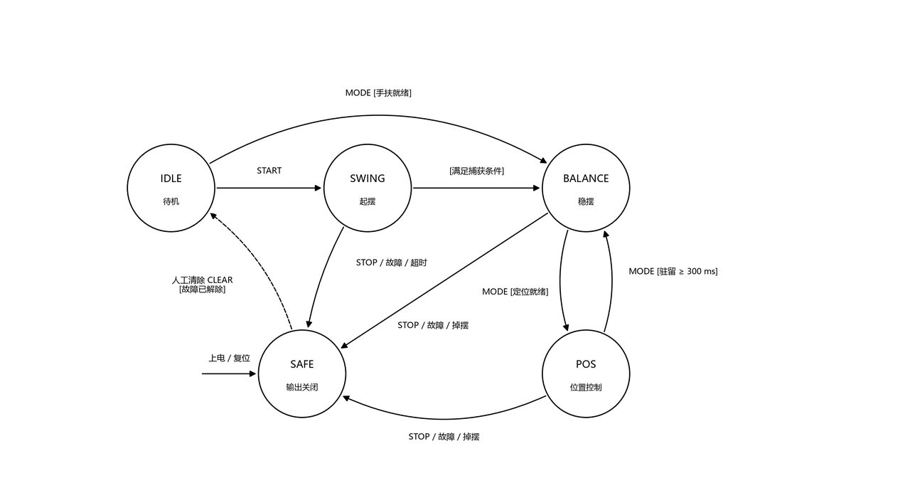

# 系统架构

## 1. 总体组成

```
┌──────────────┐   SPI mode3   ┌────────────────────────────────────────┐
│ MT6835 (摆角)│────12.5MHz───►│                                        │
│  21 位绝对角 │               │   Tang Primer 20K (GW2A-LV18PG256)     │
└──────────────┘               │                                        │
┌──────────────┐   SSI mode2   │  ┌──────────────┐  ┌───────────────┐  │
│ MT6701(电机轴)│────6.25MHz───►│  │ 传感与解算层 │  │  控制层       │  │
│  14 位绝对角 │               │  │ mt6835_spi_if│  │ mode_fsm      │  │
└──────────────┘               │  │ mt6701_ssi_if│  │ swingup_core  │  │
                               │  │ angle_proc   │  │ lqr_core      │  │
┌──────────────┐               │  │ theta_mt_path│  │ obs_core      │  │
│ 上位机 (PC)  │◄─1Mbaud UART─►│  │ arm_vel      │  │ traj_gen      │  │
│ PySide6 GUI  │  CRC16 帧     │  └──────────────┘  └───────────────┘  │
└──────────────┘               │  ┌──────────────┐  ┌───────────────┐  │
                               │  │ 输出层       │  │ 安全与调试    │  │
┌──────────────┐  PWM 21.6kHz  │  │ out_stage    │  │ safety        │  │
│ TB6612FNG    │◄───────┬─────►│  │ motor_pwm    │  │ debug_link    │  │
│ 双 H 桥      │        │      │  │ rev_guard    │  │ packet_rx/tx  │  │
└──────┬───────┘        │      │  └──────────────┘  └───────────────┘  │
       │                │      │         ▲                             │
       ▼                │      └─────────┼─────────────────────────────┘
   直流电机 ◄───────────┘              27MHz 单时钟域
       │                                   │
       ▼                                   ▼
   减速箱 20.45:1                    loop_timer 1kHz tick
       │
       ▼
   旋转臂 (θ) ──► 摆杆 (α)
```

## 2. 分层设计（本项目最重要的架构决定）

RTL 分三层，**控制核与板级完全解耦**：

```
rtl/boards/t20k/t20k_top.v     ← 板级外壳：只做引脚映射、传感/驱动接线
        │
        ├── rtl/ctrl_core.v     ← 控制核：与板无关，可整体搬到别的平台
        │       ├── angle_proc / theta_mt_path / arm_vel   （传感与解算）
        │       ├── mode_fsm                                （模式调度）
        │       ├── swingup_core                            （起摆）
        │       ├── lqr_core / obs_core                     （控制律）
        │       ├── traj_gen                                （参考轨迹）
        │       ├── out_stage / rev_guard                   （输出级）
        │       └── safety                                  （安全通路）
        │
        └── 通用底层：loop_timer / uart_rx / uart_tx /
                       packet_rx / packet_tx / debug_link
```

换板只需写一个新的 `boards/<platform>/<platform>_top.v` 与一份约束文件。
仓库中已有三套外壳（`t20k`、`de10`、`j280`）作为该设计的证明。

**控制核的边界**：`ctrl_core` 的端口只有传感器数值、命令位与输出占空比，
不含任何引脚名、器件型号或时钟频率假设（时钟频率由 `j280_defs.vh` 宏提供）。

## 3. 数据流与时间线

单时钟域 27 MHz，1 kHz 控制节拍由 `loop_timer` 的计数器分频产生单拍 `tick`：

| 相对 tick | 动作 |
|---|---|
| T-2 | `mt6835_spi_if` / `mt6701_ssi_if` 采样完成，写入 `alpha_avg` / `angle14` |
| T-1 | `angle_proc` 输出 α；`theta_mt_path` 积分输出 θ；`arm_vel` 输出 ωθ |
| T | `mode_fsm` 更新模式；`traj_gen` 推进参考；`ctrl_core` 选择控制律 |
| T+1 | `lqr_core` 启动流水（3 级：乘法 → 求和 → 移位饱和） |
| T+3 | `duty_lqr` 有效；`out_stage` 依次做软死区、速度自适应、位置摩擦补偿、换向守卫 |
| T+4 | `motor_pwm` 载入新占空比 |

采样到输出的固定延迟约 4 个控制拍，该延迟已在模型推导中计入。

## 4. 模式状态机

<div align="center">
<br/>
<sub>IDLE / SWING / BALANCE / POS / SAFE 五状态及转移条件</sub>
</div>

```
        START             捕获窗命中
IDLE ────────► SWING ──────────────► BALANCE ──┬──► POS（自动/强制）
  ▲              ▲                     │        │
  │              │  掉摆/超时          │        └──► BALANCE（退出定位）
  │              └─────────────────────┘
  │
  └── STOP / 故障 ──► SAFE（电机 coast）
```

- **IDLE**：上电静默，等待 START。参数可写。
- **SWING**：三相位甩摆（比例伺服 + 刹车 + 补甩），能量注入到摆杆过顶。
- **BALANCE**：LQR 全状态反馈，`u = K1·α + K2·ωα + K3·θe + K4·ωθ`。
  其中 θe = 目标 − θ，BALANCE 期间目标跟随臂（锚点牵引绳 ±120°）。
- **POS**：位置控制，K3/K4 抬到定位档，目标以 20°/s 斜坡推进。
- **SAFE**：故障锁存，输出封锁（coast 而非抱死）。

模式切换的增益过渡走 1 024 ms 凸组合渐变（`pos_blend`），避免硬切换冲击。

## 5. 定点数值体系

全链路无浮点、无除法器：

| 状态 | 类型 | LSB | 范围 |
|---|---|---|---|
| α 摆角 | s16 | 0.01° | ±180° |
| ωα 摆角速度 | s16 | 0.1°/s | ±1800°/s |
| θ 臂角 | s32 | 0.01° | 多圈连续 |
| ωθ 臂角速度 | s16 | 0.1°/s | ±1800°/s |
| θe 位置误差 | s16 | 0.01° | 钳位 ±45°（LQR 输入） |
| u 占空比 | s16 | 0.01% | ±9900（轨） |

增益格式：
- **LQR 增益**：Q3.13，即 `u = Σ(ki × state_i) >> 13`
- **观测器系数**：Q12.20
- **位置积分器**：`IQ_SH=11`，限幅 ±600 duty

## 6. 关键模块职责

| 模块 | 职责 | 要点 |
|---|---|---|
| `loop_timer` | 1 kHz 节拍 | 27 MHz 分频，单拍脉冲，无中断抖动 |
| `mt6835_spi_if` | 摆角读取 | mode 3、12.5 MHz、48 拍帧、CRC8 + 状态位、坏帧保持末好值 |
| `mt6701_ssi_if` | 电机轴角读取 | mode 2、6.25 MHz、25 下降沿、CRC6 + 磁场强度位 |
| `angle_proc` | α 解算与标定 | 下垂时采 2 000 拍求平均得零点（Q24 倒数乘加代替除法） |
| `theta_mt_path` | θ 解算 | 14 位模 16 384 回绕差分，单事件限幅 ±2 048，×K_Q16=7 042 积分 |
| `arm_vel` | ωθ 估计 | M 法 + T 法，4 ms 跨拍差分，Q8 指数平均 |
| `mode_fsm` | 模式调度 | 只由上位机命令与捕获/掉摆条件驱动 |
| `swingup_core` | 起摆 | 比例伺服甩摆 u=sat(KP·(θ0+δ−θ),A)，KP=9、δ=118°、A=88% |
| `lqr_core` | LQR 控制律 | 4 个 16×16 乘法并行、次拍求和、第三拍移位饱和 |
| `obs_core` | 状态观测器 | 4 状态稳态 Kalman，Q12.20 系数 |
| `traj_gen` | 参考轨迹 | 目标斜坡 + S 曲线平滑，限加速度 |
| `out_stage` | 输出整形 | 软死区（|u|<1024 比例缩放）、速度自适应、16 格位置摩擦补偿、换向守卫 |
| `rev_guard` | 换向守卫 | 120 ms 门限，防止齿轮箱高频换向 |
| `safety` | 安全通路 | 独立于控制算法，故障直接封锁输出 |
| `debug_link` | 调试链路 | CRC16 帧协议、参数事务、500 Hz 遥测 |

## 7. 上位机架构

```
gui/main.py                    ← PySide6 应用入口
  └── j280wb/app.py            ← 主窗口：总览/参数/模型/试验/录制/烧录/传感诊断
  └── j280wb/bridge.py         ← 桥线程：串口会话、命令队列、后台任务状态机
        └── host/client.py     ← 协议客户端：握手、命令、参数事务
              └── host/protocol.py  ← 帧编解码、CRC16、遥测字段定义
              └── host/devices.py   ← 设备抽象（实板/回放/模拟/HIL 锁步）
              └── host/schema.py    ← 参数表与 schema 指纹校验
```

桥线程独立于 GUI 线程，所有串口 I/O 与命令排队在桥线程内完成，
GUI 只通过 `submit()` 提交命令、通过回调接收采样。这样即使串口阻塞
也不会卡住界面（实际调试中 CH340 会周期性停顿数十秒）。
