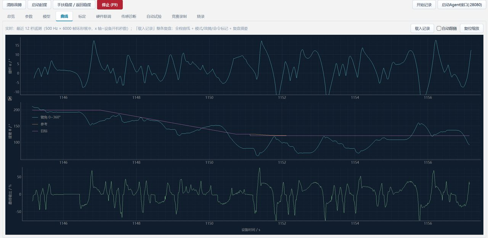

# 控制设计

## 1. 系统建模

旋转倒立摆是两个耦合的欠驱动系统：电机驱动旋转臂（θ，可直接控制），
摆杆（α，仅通过臂的加速度间接影响）。

**状态向量**（本项目采用顺序）：

```
x = [α, α̇, θ, θ̇]ᵀ      α = 摆杆与竖直向上夹角，θ = 臂转角
```

**非线性动力学**（拉格朗日形式，`matlab/j280_plant_rhs.m`）：

```
(J_arm + m·L² + J_rod)·θ̈ + m·L·l·α̈·cos(α) − m·L·l·α̇²·sin(α) = τ − τ_friction(θ̇)
(J_rod + m·l²)·α̈ + m·L·l·θ̈·cos(α) − m·g·l·sin(α) = 0
```

**线性化**（在 α=0 直立点、θ̇=0）：

```
A = [  0      1        0     0 ]
    [ a21    0        0     0 ]      a21 = (m·g·l·(M_total))/(denominator) > 0
    [  0      0        0     1 ]
    [ a41    0        0     0 ]      a41 = −(m·g·l·M_arm)/(denominator) < 0
B = [ 0, b2, 0, b4 ]ᵀ
```

关键性质：**A 有一个正实极点**（开环不稳定，α 方向的倒立平衡点），
且 **θ 通道是非最小相位**的（推臂时摆杆先反向倒，臂先被反作用力拉回）。

**辨识结果**（本项目实测，见 `matlab/`）：
- 悬挂摇摆频率 1.74 Hz → 反解 `J_rod ≈ 7.0e-4 kg·m²`
- 直立不稳定率 ≈ **11.0 rad/s**
- 摩擦：静摩擦带 640~740 duty（0.01%），随转角起伏（16 格位置相关）

## 2. LQR 设计

**代价函数**：`J = ∫ (xᵀQx + Ru²) dt`，`R = 1`

Q 权重（臂角权重用于位置控制的强弱）：

```
Q = diag([q_alpha, q_alphadot, q_theta, q_thetadot])
```

MATLAB 求解 `K = lqr(A, B, Q, R)`，得到 4 个增益，再定点化：

```
K_rtl = round( −K([2 4 1 3]) · (duty_full/V_bus) · π/[18000 1800 18000 1800] · 2^13 )
```

注意状态顺序映射 `[2 4 1 3]`（MATLAB 用 `[θ, α, θ̇, α̇]`，RTL 用 `[α, α̇, θ, θ̇]`），
以及单位换算（rad → 0.01°、rad/s → 0.1°/s、伏特 → 占空比）。

**当前部署增益**（满电实测最优，见 `docs/tuning-guide.md`）：

| 模式 | K1 | K2 | K3 | K4 |
|---|---|---|---|---|
| BALANCE | 17751 | 10000 | 600 | 5300 |
| POS | 17751 | 10000 | 1200 | 9500 |

**K3/K4 为什么分模式？** 稳摆只需弱位置刚度（K3=600，臂可自由移动吸收扰动），
定位需要强位置刚度（K3=1200）与臂速阻尼（K4=9500）。切换走 1 024 ms 凸组合渐变。

**K4 的甜点特性（重要）**：K4 同时是臂速阻尼和能量泵。太小臂会飞（阻尼不足），
太大则把臂速噪声放大成泵摆。实测满电甜点 9 500~14 000，60% 电量约 8 000，
越过 16 000 直接泵摆掉杆。**K4 的有效增益正比于电池电压**。

## 3. 定点化与流水

`lqr_core` 三级流水（27 MHz 下单拍余量充足）：

```
S1: p1 = alpha × k1,  p2 = alpha_dot × k2,  p3 = θe × k3,  p4 = θ̇ × k4   （4 个 16×16）
S2: acc = p1 + p2 + p3 + p4                                              （34 位求和）
S3: u = sat16((acc + 2^12) >> 13)                                        （Q3.13 → duty）
```

- 增益域 ±32767（Q3.13 下最大 ±4.0 的物理增益）
- 加法带 `+4096` 是四舍五入（`>>13` 前加半 LSB）
- 饱和到 ±32767，避免 16 位溢出

**为什么不用除法器？** `angle_proc` 标定需要求平均，用 Q24 倒数乘加代替除法；
`traj_gen` 的加速度限制用比较+步进代替。全设计无 `divide` IP。

## 4. 观测器

`obs_core` 实现 4 状态稳态 Kalman 滤波器，系数 Q12.20（`matlab/obs_to_rtl.m` 生成）。

作用：
- 从含噪的 α/α̇ 估计更干净的 α̇（抑制量化台阶）
- 提供 θ 的平滑估计（电机侧编码器经 20.45:1 折算后量化较粗）

**注意**：观测器 `R_α` 必须按负载噪声标定，不能用静止本底。
本项目曾因用静止本底标定导致 α̇ 幻影振铃（±300°/s @ 25 Hz），
bang-bang 推杆过顶摔摆。当前 `OBS_USE` 可运行时切换，便于 A/B。

## 5. 输出级整形

<div align="center">
<br/>
<sub>稳摆实板波形：α（上）/ θ 0~360°（中）/ 输出 duty（下）</sub>
</div>

`out_stage` 是控制量与执行器之间的四道处理，**位置精度的关键战场**：

### 5.1 软死区补偿

电机 + 齿轮箱有静摩擦死区（实测正 640 / 负 740 duty，单位 0.01%）。
补偿策略：

```
if |u| < DZ_SOFT_TH (=1024):
    u_comp = u + sign(u) × dz_scale(|u|)      # 按比例从 0 线性升到全值
else:
    u_comp = u + sign(u) × dz_full
```

硬跳变（0 → 全值 1380 duty）会造成过零冲击"咔咔"响并激励齿轮箱共振；
软死区把跳变从 2017 duty 降到 911 duty，显著降噪。

### 5.2 速度自适应

死区补偿的力度随臂速调制：

```
scale = clamp(|ωθ| / DZ_THDOT_REF, 0.2, 1.0)     DZ_THDOT_REF = 2500 (250°/s)
```

低速时补偿打折（避免过补偿推动臂），高速时全额（克服摩擦）。
**这个参数曾长期设置错误**：REF=1000 时实际补偿只有需求的 20~42%，
导致位置误差直流偏置 16~23°。修正到 2500 后误差峰峰降低 22%。

### 5.3 位置相关摩擦补偿（16 格 LUT）

静摩擦随转角起伏（臂在不同角度的摩擦带不同），用 16 格（22.5°/格）LUT
补偿 `dz(θ)`。实测各格突破力矩 1200~2600 duty，高格区（45~112.5°）
摩擦最大。

**风险**：高格区补偿过推会激励泵摆，是运动穿越时掉摆的主要原因。
当前固件在该区（`dz_idx ∈ [2,4]`）加了坏区阻尼器（|α̇|>30°/s 时注入
0.25×K4 的臂速阻尼）。

### 5.4 换向守卫

齿轮箱不允许高频换向（会砸坏齿面）。`rev_guard` 在检测到符号翻转后
120 ms 内禁止再次换向，同时 `REV_HYST` 提供方向滞回。

实测：无守卫时 duty 符号翻转 7.2 次/s，齿轮箱"咔咔"共振；
加守卫后降到可接受水平。

## 6. 起摆策略

三相位甩摆（`swingup_core`）：

1. **加速相**：比例伺服 `u = sat(KP·(θ0 + δ − θ), A)`，KP=9、δ=118°、A=88%
   把臂从静止加速到峰值速度，能量注入摆杆
2. **刹车相**：检测到峰值速度后反向刹车 440~470 ms，把臂动能转为摆杆势能
3. **补甩相**：若摆杆未达捕获条件，重新蓄力再甩

**捕获条件**（进入 BALANCE 的门）：
- `|α| < CATCH_ALPHA_MAX`（9000 cdeg = 90°，实际窗口由状态组合判定）
- `|α̇| < CATCH_ADOT_MAX`
- `|θ̇| < CATCH_TD_LIM`（臂速门，**这个门是关键**：臂速过快时摆杆带着动量
  入窗，BAL 接不住）

**捕获增强相**：进入 BALANCE 后 800 ms 内 K2/K4 提到 13/8 倍（杆阻尼+臂阻尼），
实测把捕获后存活时间从 1.1~1.4 s 提到 10~23 s。

**已知问题**：满电极端条件下捕获增强目标 = POS K4，若 POS K4 过高（如 11 000）
会撞上"捕获增益悬崖"——BAL 在增强窗结束时直接掉。当前 POS K4 下调至 9 500 规避。

## 7. 位置控制

### 7.1 目标斜坡

MOVE 命令不是阶跃，而是 20°/s 的目标斜坡（`POS_SLEW_DIV=2`，4 c01/2ms）：

```
pos_tgt += clamp(pos_tgt_cmd − pos_tgt, ±4 c01)   每 2 ms
```

**为什么斜坡？** 阶跃目标会让 K3 弹簧瞬间输出大 duty，激励臂-摆耦合振荡。
20°/s 下位置误差始终小，弹簧平稳。

### 7.2 绝对目标（MOVE_ABS）

相对 MOVE 的问题是：delta 由上位机按**点击那一刻**的 θ 计算，
固件执行时 `cmd = 执行θ + delta`；排队延迟 + 保持窗期间臂还在移动，
终点就偏了（实测偏 10°）。

MOVE_ABS 直接传**绝对目标**，固件执行拍 `pos_tgt_cmd <= 目标`，不经 θ+delta。
隔离复测 6/6 段 Δ=0.0°。

**约束**：做 wrap180 最短路会引入取模运算，Fmax 从 27 MHz 掉到 15.7 MHz。
解法：上位机算最近 360° 等价角，固件只做一次 ±360° 修正（无取模）。

### 7.3 稳定窗与重锚

进入 POS 后有 1 500 ms 稳定窗，期间目标跟踪臂（弹簧中性），
让入场残余能量衰减、K3/K4 渐变走完，再放行轨迹。

`rehold` 看门狗：保持态下 `|θe| > 120°` 触发重锚（目标跟到当前臂位）。
**重要**：rehold 必须用未钳位的 `theta_e_raw`（θe 钳位 ±45° 会把它变成死代码）。

## 8. 静摩擦锁保持

`FRICTION_LOCK`：POS 保持态下，若安静（`|te|≤8°`、`|α|≤2.4°`、`|θ̇|≤50°/s`、
`|α̇|≤30°/s`）且目标已停走持续 250 ms → **duty 强制 0**。

原理：旋转倒立摆可被轴系静摩擦卡死，此时磁编码器读数完全恒定（真静止）。
零扭矩保持 = 零功耗、零抖动。唤醒条件：`|α|>3.5°` / `|α̇|>80°/s` / `|te|>12°` / MOVE。

实测 duty 恒零最长连续 2.81 s，占比 3.7%。

## 9. 增益调度

```
模式       K3      K4      说明
BALANCE    600     5300    弱位置刚度，臂自由吸收扰动
POS       1200     9500    强位置刚度 + 臂速阻尼
MOVE      360      9000    移动期软化 K3（防弹簧打架），保留 K4（臂阻尼）
```

切换用 1 024 ms 凸组合：

```
k3_eff = k3 + (pos_k3 − k3) × blend / 1024
```

**MOVE 期 K4 不能软化**（实测教训）：历史上 MOVE 期 K4 软到 4 000，
在 65% 电量下勉强可用，满电下运动中必掉（臂阻尼被撤掉）。

## 10. 调试方法论（本项目最宝贵的经验）

1. **逐帧回放 + 探针字段**：500 Hz 遥测带 4 个诊断探针，可逐帧归因
2. **单变量原则**：一次只改一个参数/机制，否则无法归因
3. **仿真不等于实机**：多次"仿真通过就上板"直接摔摆
4. **参数甜点随物理条件漂移**：K4 随电池电压移动、trim 随标定移动
5. **数据驱动的相对分析**：绝对尺度模型不可信（辨识模型判现役增益发散，
   但实机稳），只能用闭环数据的相对量（阻尼、包络、频谱）
