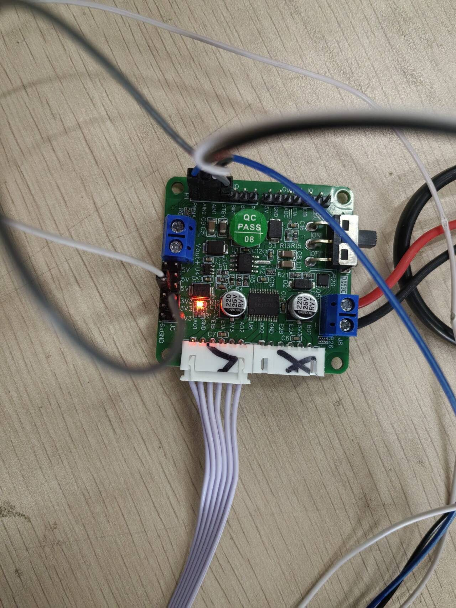
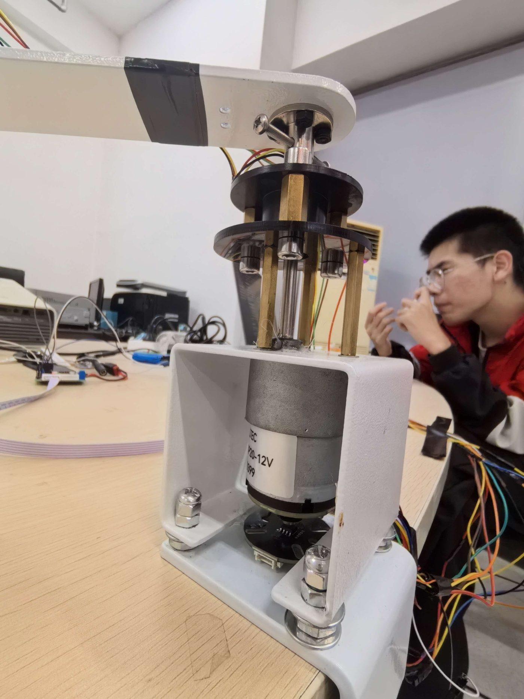

# 硬件

## 1. 平台

| 项 | 规格 |
|---|---|
| 主控 | Sipeed Tang Primer 20K 核心板 + Dock 底板 |
| 器件 | 高云 GW2A-LV18PG256C8/I7（20 736 LUT4、15 552 FF、29 BSRAM、20 DSP） |
| 时钟 | 27 MHz 板载晶振直驱（无 PLL，单时钟域） |
| I/O 电平 | LVCMOS33（Dock 底板 bank 默认 3.3 V） |

## 2. 引脚分配（Tang Primer 20K）

完整约束见 `cons/t20k.cst`（26 个 IO_LOC）。

### 2.1 时钟与按键

| 信号 | 引脚 | 说明 |
|---|---|---|
| `clk27` | H11 | 27 MHz 晶振 |
| `key_n[0]` | C7 | 启动（低有效） |
| `key_n[1]` | D7 | 模式切换 |
| `key_n[2]` | T2 | 标定 |
| `key_n[3]` | T3 | 急停 |
| `key_n[4]` | T10 | 复位 |

### 2.2 状态指示

| 信号 | 引脚 | 说明 |
|---|---|---|
| `led[3:0]` | N16 N14 L14 L16 | 控制器状态 |
| `led[4]` | A13 | 节拍慢闪（心跳） |
| `led[5]` | C13 | 故障指示 |

### 2.3 串口（PMOD2）

| 信号 | 引脚 |
|---|---|
| `uart_tx` | B12 |
| `uart_rx` | C12 |

外接 3.3 V CH340 模块，1 Mbaud 全双工。

> **重要**：Type-C 口专用于 JTAG 烧录，**不承载串口**。
> 烧录与串口是两条独立线缆，因此烧录时无需断开 CH340 的串口连接
> （但部分工具会争用 USB 枚举，稳妥做法是烧录前断开）。

### 2.4 摆角传感器 MT6835（SPI，PMOD1）

| 信号 | 引脚 |
|---|---|
| `spi_csn` | D14 |
| `spi_sck` | E15 |
| `spi_mosi` | B14 |
| `spi_miso` | A15 |

SPI mode 3、12.5 MHz、单帧 48 拍、帧周期约 20 μs（轮询约 50 kHz），
返回 21 位角 + 3 位状态 + CRC8。

### 2.5 电机轴编码器 MT6701（SSI，PMOD1）

| 信号 | 引脚 |
|---|---|
| `mt6701_sck` | M15 |
| `mt6701_do` | J16 |
| `mt6701_csn` | B13 |

SSI mode 2（CLK 空闲高）、6.25 MHz、每帧 25 个下降沿
（1 哑位 + 14 位角 + 4 位磁场状态 + CRC6）。

### 2.6 电机驱动 TB6612FNG

| 信号 | 引脚 |
|---|---|
| `mot_ain1` | T12 |
| `mot_ain2` | R11 |
| `mot_pwma` | M14 |
| `mot_stby` | J14 |

PWMA 载波 21.6 kHz（1 250 级），AN1/AN2 为 01/10 正反转、00 coast、11 短路制动。

<div align="center">
<br/>
<sub>TB6612FNG 双 H 桥驱动板（本设计只用通道 A）</sub>
</div>

## 3. 机械本体

<div align="center">
<br/>
<sub>官方套件本体：白色摆臂绕竖直轴旋转（θ），末端铰接摆杆（α），底部 12 V 直流电机经 20.45:1 减速箱驱动</sub>
</div>

官方旋转倒立摆套件（不含原控制板）：

```
     摆杆 (α)  ← 绕水平轴摆动，与竖直向上夹角为 α
        │
        │ 铰接轴承
        │
    ────┴──── 摆臂（水平伸出）
        │
        │
    ╔═══╧═══╗
    ║ 云台   ║  ← 绕竖直轴旋转，转角为 θ
    ╚═══╤═══╝
        │
    ┌───┴───┐
    │ 减速箱 │  20.45:1
    └───┬───┘
        │
    直流电机
```

**关键机械特性**（直接影响控制设计）：

1. **齿轮箱齿隙**：换向存在空程，输出级设换向滞回与齿隙补偿
2. **静摩擦随转角起伏**：实测突破力矩 1 200~2 600 duty（0.01% 占空比），
   位置保持设 16 格位置相关补偿 LUT
3. **静摩擦可卡死**：安静时摆杆可被轴系摩擦顶住，磁编码器读数完全恒定
   （这是 `FRICTION_LOCK` 零扭矩保持的物理基础）
4. **齿轮箱禁高频换向**：会砸坏齿面，`rev_guard` 设 120 ms 门限

## 4. 传感器安装要点

### 4.1 MT6835（摆杆侧）

- 磁铁与编码器定子同轴安装，间隙满足数据手册要求
- 经 **6 线滑环**引出（云台旋转时线缆不能缠绕）
- 滑环换向会偶发单帧坏帧 → 固件用 CRC8 + 状态位 + 宽限判定
- **安装偏心会导致 α 零位随 θ 呈 1 周期波动**（实测幅值约 1°，残差 0.09~0.13°）

### 4.2 MT6701（电机轴侧）

- 直接读电机轴，经 **20.45:1 减速比**折算得到臂角
- 分辨率：14 位 / 360° / 20.45 = 每计数约 0.0026°（臂侧）
- 测速量化：1 计数/ms ≈ 1.07°/s
- **重要**：电机满舵大电流会干扰轴上磁铁，导致 θ 读数被 duty 调制
  （实测 ±1.2°/全舵、同相）。这是"甩摆时 30~60 Hz 满舵共振"的真因之一

## 5. 升级建议（已知的改进方向）

| 方向 | 收益 | 代价 |
|---|---|---|
| 臂角改用直测磁编码器（MT6835 或同款） | 消除齿轮扭转掩蔽（约 0.1~0.3°）、θ̇ 更干净 | 需第二路 SPI + 源选择；安装偏心须重新标定 |
| 更强径向磁铁（摆杆侧） | 压缩 α 零位漂移与 α̇ 噪声 | 机械改动 |
| 编码器远离电机磁场 | 消除 duty 调制干扰 | 布线改动 |
| 电机电流采样 | 可做力矩闭环 | 需 ADC 通道 |

**注意**：换传感器不会让位置精度从 10° 降到 2°——误差主体是执行器侧
（静摩擦、齿隙、自持极限环），不是测量侧。测量改进的收益是"边际改善"，
真正的杠杆是降机械摩擦。
